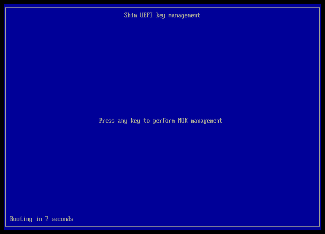
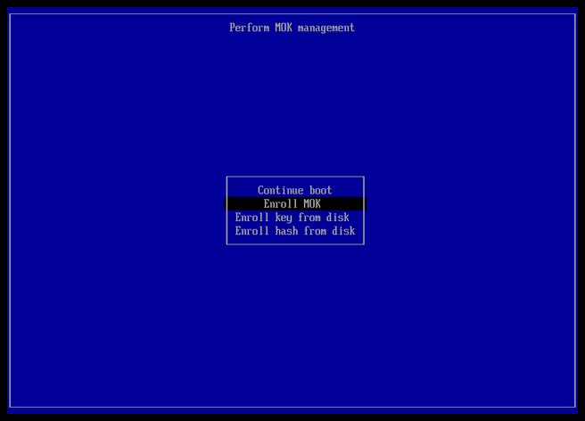
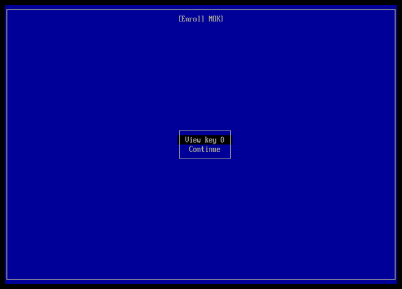
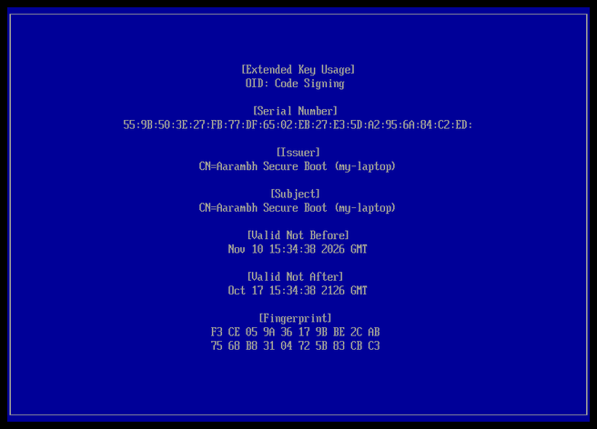
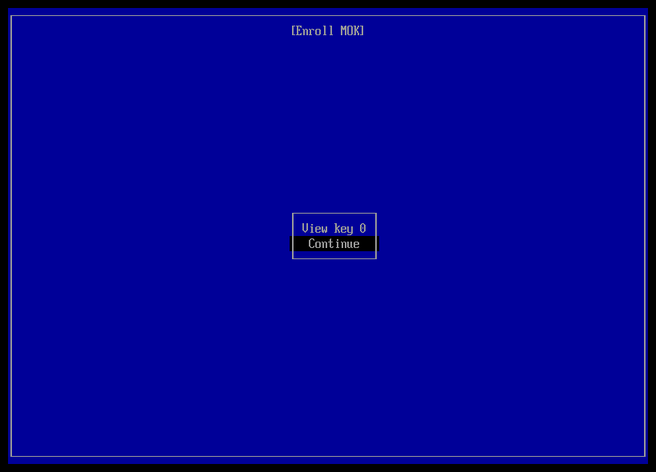
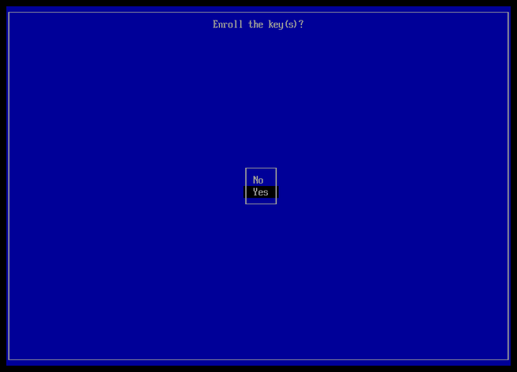
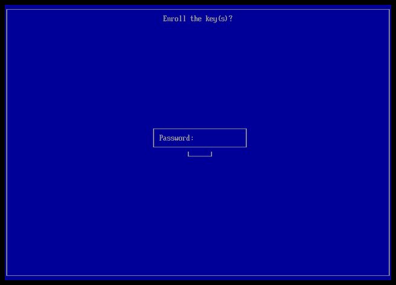
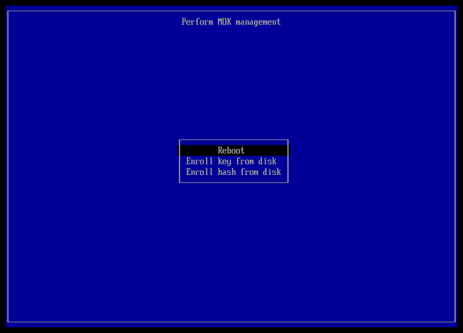
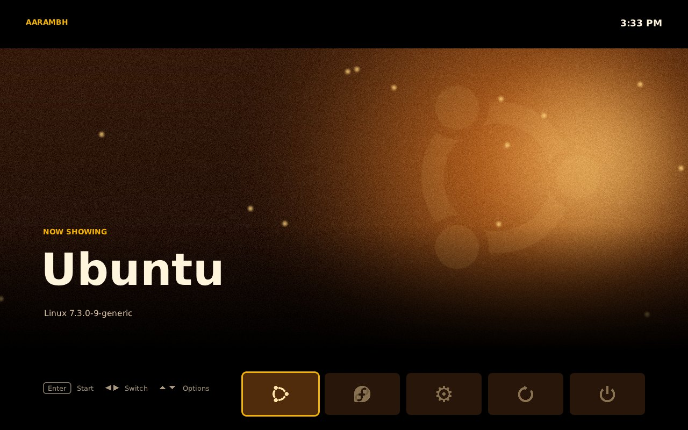
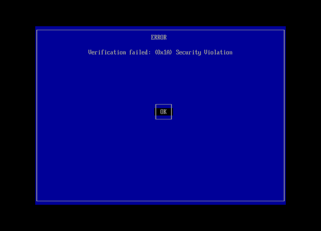

# Installing Aarambh with Secure Boot on

Aarambh works with Secure Boot on. You do not edit any file and you do not
sign anything yourself: `make install` does all of it. The only thing you may
have to do is **confirm a key once**, on a blue screen at the next restart,
with an 8-digit password the installer gives you. This guide walks through
that screen by screen.

- [How it works, in short](#how-it-works-in-short)
- [Before you start](#before-you-start)
- [Step 1: install](#step-1-install)
- [Step 2: enroll the key at the next restart](#step-2-enroll-the-key-at-the-next-restart)
- [Step 3: check that it worked](#step-3-check-that-it-worked)
- [Other Linux systems on the same disk](#other-linux-systems-on-the-same-disk)
- [Turning Secure Boot on later](#turning-secure-boot-on-later)
- [The password: every question answered](#the-password-every-question-answered)
- [When something goes wrong](#when-something-goes-wrong)

## How it works, in short

Your PC only starts programs signed with a key it trusts. Every PC trusts
Microsoft's key, and Microsoft signs **shim**, a small program your
distribution already ships. Shim keeps its own list of extra trusted keys,
the **MOK** list (Machine Owner Keys), and only you, at the keyboard, can add
a key to it.

```
Firmware (trusts Microsoft's key)
  → shim          your distribution's, signed by Microsoft
  → Aarambh       signed with your key, which shim trusts once you enroll it
  → your system   Aarambh asks shim to check every kernel and loader it starts
```

So the installer:

1. Finds your distribution's shim on the EFI partition and copies it next to
   Aarambh.
2. Picks a signing key. It reuses a key the PC already trusts when shim
   accepts it for boot loaders; otherwise it creates one for this system in
   `/var/lib/aarambh/keys/`.
3. Signs Aarambh and the kernel it starts directly.
4. If the key is not trusted yet, asks shim to enroll it at the next restart,
   protected by an 8-digit password, and shows you that password.

The key never leaves your PC and the private half is readable only by root.

## Before you start

**Check that Secure Boot is on** (if it is off, Aarambh still installs signed,
so turning it on later just works; see
[Turning Secure Boot on later](#turning-secure-boot-on-later)):

```sh
mokutil --sb-state
```

`SecureBoot enabled` means on. If `mokutil` is not installed yet, the
installer installs it.

**Your distribution's shim must be installed.** It almost always is, because
it is what starts GRUB with Secure Boot on:

| Distribution        | Package |
|---------------------|---------|
| Debian, Ubuntu      | `shim-signed` |
| Fedora              | `shim-x64` |
| openSUSE            | `shim` |
| Arch                | not shipped; use `sbctl` keys instead (the installer picks them up) |

The signing tools (`sbsigntool` or `sbsigntools`, `mokutil`, `openssl`) are
installed by the installer itself with your package manager.

**Keep a keyboard at hand** for the next restart. A wireless keyboard that
only works once the OS is up cannot type in the blue screen.

## Step 1: install

```sh
make install
```

Near the start, the installer shows what it found:

```
aarambh: secure boot:     on, signed with /var/lib/aarambh/keys/aarambh.der, started by /boot/efi/EFI/ubuntu/shimx64.efi
```

- `on`: Secure Boot is on (`off` is fine too).
- `signed with …`: the key Aarambh is signed with.
- `started by …`: the shim that starts Aarambh.

At the end, **if the key still has to be enrolled**, it shows the password:

```
aarambh: Secure Boot: one step is left, only once, at the next restart.
aarambh:   A blue 'Perform MOK management' screen appears. Choose:
aarambh:   Enroll MOK -> Continue -> Yes, type the password: 49173582 -> Reboot
aarambh:   Forgot it? 'sudo aarambh-sign --password' shows it again. If you miss
aarambh:   the screen, nothing breaks: the PC starts your OS's own boot loader
aarambh:   and the screen comes back at the following restart.
```

Your password will be a different 8-digit number. **Write it down** or keep
the terminal open. You can always see it again with:

```sh
sudo aarambh-sign --password
```

If this block does **not** appear, your PC already trusts the key: skip to
[Step 3](#step-3-check-that-it-worked).

## Step 2: enroll the key at the next restart

Restart. Before Aarambh appears, shim opens **MokManager**, a plain blue
screen. Use the arrow keys to move, **Enter** to choose.

### 2.1 Press a key within 10 seconds



The countdown at the bottom left runs for 10 seconds. **Press any key**
before it ends. If you miss it, nothing breaks; see
[I missed the blue screen](#i-missed-the-blue-screen).

### 2.2 Choose Enroll MOK



Move down to **Enroll MOK** and press Enter. Do not pick *Enroll key from
disk* or *Enroll hash from disk*: the key is already waiting, you only
confirm it.

### 2.3 Optional: look at the key



**View key 0** shows the key you are about to trust:



A key made by Aarambh is called **Aarambh Secure Boot (your computer's
name)** and is marked **Code Signing**. Press any key to go back.

### 2.4 Choose Continue



### 2.5 Choose Yes



*Enroll the key(s)?*: move down to **Yes** and press Enter.

### 2.6 Type the password



Type the 8-digit password from Step 1 and press Enter.

- **Nothing appears while you type**, no stars, no dots. That is normal,
  as with `sudo` in a terminal.
- Use the **number row above the letters**, not the numeric keypad (it does
  nothing while Num Lock is off).
- If you mistype, Backspace works even though you cannot see it, or press
  Enter and try again: you get three tries.

### 2.7 Choose Reboot



The menu now shows **Reboot** at the top: the key is enrolled. Press Enter.
The PC restarts and Aarambh appears.



You never see this blue screen again, unless you enroll another key.

## Step 3: check that it worked

In your OS:

```sh
mokutil --sb-state
mokutil --test-key "$(sed -n 's/^SIGN_DER=//p' /etc/aarambh.env)"
aarambh-debug
```

- `SecureBoot enabled`
- `… is already enrolled`
- In the `aarambh-debug` summary: `aarambh.efi is signed with this OS's key`,
  `the signing key is enrolled in MOK` and `this boot started through
  Aarambh`.

## Other Linux systems on the same disk

Run the setup once in **each** other Linux, as for any Aarambh install:

```sh
sudo bash /boot/efi/EFI/aarambh/hooks/setup.sh
```

Each system signs its own copy of its kernel with its own key, so every
system boots directly whichever shim started Aarambh. If that system's key is
not trusted yet, the same blue screen appears once more at the next restart,
with **that system's** password (shown by its `setup.sh`, and by
`sudo aarambh-sign --password` in that system).

## Turning Secure Boot on later

Aarambh is signed even while Secure Boot is off, and no blue screen appears
then. When you turn Secure Boot on in the firmware setup:

1. The first start cannot open Aarambh yet; the PC starts your OS's own boot
   loader instead (you may see
   [Verification failed](#verification-failed-0x1a-security-violation) first;
   press Enter on **OK**).
2. In that start, Aarambh notices that Secure Boot is on and asks shim to
   enroll the key. Read the password with `sudo aarambh-sign --password`.
3. Restart and follow [Step 2](#step-2-enroll-the-key-at-the-next-restart).

## The password: every question answered

### Where does the password come from?

The installer makes it on your PC: eight random digits, saved in
`/var/lib/aarambh/keys/mok-password`, readable only by root. It is shown in
the terminal and by `sudo aarambh-sign --password`. Nobody else has it, and
it is not sent anywhere.

### Why do I need a password at all?

Shim asks for it to be sure that the person confirming the key at the
keyboard is the same person who asked for it in Linux. The real protection is
that a key can only be added by someone **at the keyboard** during startup;
no program can press *Yes* for you.

### Why only digits?

MokManager reads every keyboard as a US layout. On many layouts the letters
and symbols sit on other keys (on a French keyboard, `a` types `q`), but the
digits are on the same keys everywhere, so a digit password always works.

### Can I choose my own password?

Not on the blue screen: MokManager only checks the password that was set when
the key was queued. You can set your own **before** restarting:

```sh
sudo mokutil --revoke-import
sudo mokutil --import "$(sed -n 's/^SIGN_DER=//p' /etc/aarambh.env)"
```

The second command asks for the new password twice. Then store it, so
`aarambh-sign --password` shows the right one (type it, press Enter, then
Ctrl+D):

```sh
sudo sh -c 'umask 077; cat > /var/lib/aarambh/keys/mok-password'
```

Keep it to digits, for the reason above.

### Is it a secret after the key is enrolled?

No. It is only used once, to confirm that one request. After the key is
enrolled it protects nothing. A new request always gets its own password, and
only root can make one. You may delete the file:

```sh
sudo rm /var/lib/aarambh/keys/mok-password
```

### I forgot the password

```sh
sudo aarambh-sign --password
```

If the file is gone, queue the key again with your own password (see
[Can I choose my own password?](#can-i-choose-my-own-password)).

### MokManager says the password is wrong

Check it with `sudo aarambh-sign --password`, then type it with the number
row. After three wrong tries MokManager restarts the PC; the request stays
and the blue screen comes back at the next restart.

### Why not use the key my PC already has for NVIDIA or other drivers?

Ubuntu and DKMS create that key for kernel modules only, and shim refuses to
start a boot loader signed with such a key, even when it is enrolled. Aarambh
checks this and makes a key of its own instead. Your driver key stays as it
is.

### How do I remove the key again?

`hooks/uninstall.sh --purge` asks shim to remove Aarambh's own key (never a
driver or distribution key) at the next restart. The same blue screen appears
with **Delete MOK** instead of *Enroll MOK*: choose **Delete MOK → Continue →
Yes**, type the password the uninstaller shows, then **Reboot**.

## When something goes wrong

### Verification failed: (0x1A) Security Violation



Shim does not trust the key Aarambh is signed with (yet). Press Enter on
**OK**. Shim then opens MokManager; choose **Continue boot**, and the PC
starts your OS's own boot loader. In the OS:

```sh
sudo aarambh-sign             # asks shim to enroll the key
sudo aarambh-sign --password  # the password for the blue screen
```

Restart and follow [Step 2](#step-2-enroll-the-key-at-the-next-restart). If it
happens again **right after** enrolling, run `aarambh-debug`: it reports when
the key is one shim refuses for boot loaders.

### I missed the blue screen

Nothing breaks. Shim could not start Aarambh without the key, so the PC
started your OS's own boot loader. The request is still there (Aarambh queues
it again at every start until it is enrolled), so the blue screen comes back
at the next restart.

### The blue screen comes back at every restart

The enrollment was not confirmed. Do
[Step 2](#step-2-enroll-the-key-at-the-next-restart) once. If you would rather
not use Secure Boot, turn it off in the firmware setup: Aarambh keeps working
and stops asking.

### Aarambh does not start after a restart, the OS starts directly

Some firmware moves a boot entry down after it failed once, or keeps its own
boot order. Check:

```sh
sudo efibootmgr | head -3
```

If `BootOrder` does not begin with the **Aarambh** entry, run `make install`
again, which puts it first. If the firmware puts it back down at the next
restart, open the firmware setup (often F2 or Del at power on), go to the
**Boot** page and move **Aarambh** to the top once.

### Still stuck

Run `aarambh-debug` and attach the report to a
[new issue](https://github.com/NarkAgni/aarambh/issues/new). It contains the
Secure Boot state, the signatures, the enrolled keys and the boot entries, and
no passwords.